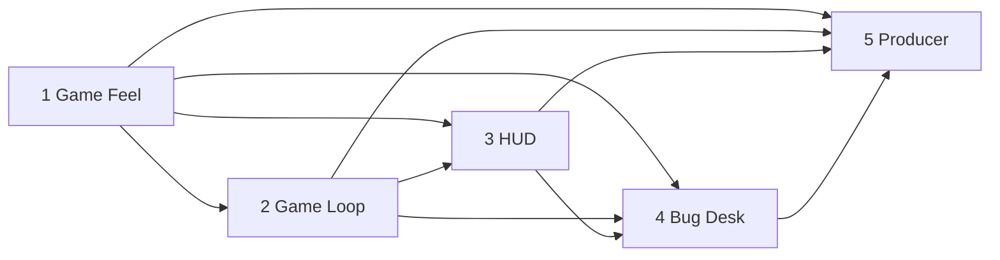

# Grok Bot AI Gaming Team by Meta Alchemist

Created by [@meta_alchemist](https://x.com/meta_alchemist). MIT licensed.

A pack of AI game-dev helpers. Each one looks at one part of your game, grades what you captured, and drafts fixes for you to approve. You stay in charge. Nothing is posted, filed, or sent until you do it.

It is for solo developers and small teams, in any genre, on any engine. A platformer, a mobile puzzle, a farming sim, a story game, a racing game, or an online arena all fit.

## What this helps with

- Grade a playable build with a 100-point rubric, using captures you already have. Missing evidence scores zero, never a guess.
- Start with five helpers: Game Feel, Game Loop, HUD, Bug Desk, and Producer. Add more only when you need them.
- Get local drafts of fixes, tickets, and plans. You decide what to file or ship.
- Keep several helpers in sync through files in your game project, so you do not retype the same notes.

## Works with any AI, not just Grok Bot

The templates are plain files: skill instructions, memory facts, prompts, and a rubric. There is no exclusive Grok Bot plug-in you have to wait for. Paste or upload the files, then use the first prompt in that template's README.

| Tool | How to start |
|---|---|
| Grok Bot | Paste each `SKILL.md` into a chat and say "Save this as a skill." Then paste the first prompt. Share links are coming soon. |
| Claude (Projects or Claude Code) | In a Project, upload the `SKILL.md` files (and `MEMORY.md` if you want). In Claude Code, put each skill at `.claude/skills/<name>/SKILL.md`, or point `CLAUDE.md` at the folder. Then paste the first prompt. |
| ChatGPT (Custom GPT or a Project) | Paste or upload the `SKILL.md` files as the GPT or Project instructions. Then start a chat with the first prompt. |
| Codex | Point `AGENTS.md`, or the skills folder your Codex setup reads, at the `SKILL.md` files. Copy `engine/` and `fixtures/` into your repo if you want the local grader. Then paste the first prompt. |
| Cursor | Put each skill at `.cursor/skills/<name>/SKILL.md`, or mention the folder in `AGENTS.md` or project rules. Then paste the first prompt. |
| Gemini (Gems or Gemini CLI) | For a Gem, paste the skills and the first prompt as the Gem instructions. For Gemini CLI, point `GEMINI.md` at the files, or paste them as context. |

The same paste steps work in any other chat that accepts a long file. More detail is in [INSTALL.md](INSTALL.md) and [guides/pairing-other-llms.md](guides/pairing-other-llms.md).

## What else is in the repo

- 100-point grading rubrics and a small local grader (`engine/lens.mjs`) you can run with Node 18 or newer. See [READINESS.md](READINESS.md) for what is shipping, preview, or still missing.
- A [team map](docs/TEAM-MAP.md) of how helpers hand files to each other, plus shared memory under `.grokbot-team/` in your game project.
- Engine tests, a kit validator (`npm run check`), versioning rules, and a synthetic worked example in [examples/pixel-pantry/](examples/pixel-pantry/).
- An MIT license. Please keep the [@meta_alchemist](https://x.com/meta_alchemist) credit if you fork a template or a skill.

## Five minute quickstart

You do not need all 24 bots. Start with five, in this order: **Game Feel**, **Game Loop**, **HUD**, **Bug Desk**, **Producer**. The reasons, the paste steps, and a first prompt for each one are in [Get started with your AI gaming team](GETTING-STARTED.md).

1. Download or clone this repo.
2. If you have Node 18 or newer, grade the sample. It is synthetic, not your game. From this folder:

```bash
node templates/01-game-feel/engine/lens.mjs templates/01-game-feel/fixtures/good-pack.json
```

You should see `"verdict": "PASS"` and `"grade": 100`.

3. Add Game Feel next, from `templates/01-game-feel`. Share links are coming soon, so paste each skill file into your AI chat (in Grok Bot, say "Save this as a skill."). The guide has the exact words. This is the first prompt: `Run the game-vibes-getting-started skill.`

Or paste this into Grok Bot, or into any other AI, to start the whole starter team:

```
I have the Grok Bot AI Gaming Team repo on my computer. Help me set up my AI gaming team.

Start with five templates, in this order: Game Feel (templates/01-game-feel), Game Loop (templates/05-game-loop-alchemist), HUD (templates/09-hud-designer), Bug Desk (templates/18-bug-desk-triage), and Producer (templates/12-parallel-game-producer). Ask me one question at a time about my game.

For each template, load every SKILL.md in its skills/ folder (the skill whose name ends in -lens-engine first, then the one that ends in -getting-started, then the rest) and the facts in MEMORY.md. Then run the getting-started skill named in that template's README. Use the first prompt in the README after the skills are loaded.

Do not post, file, email, or send anything until I say so.
```

Stuck? Read the [FAQ](FAQ.md). The full list of bots is the [catalog](TEMPLATES.md).

## The five bots to start with

| Order | Bot | Add it when | Folder |
|---|---|---|---|
| 1 | Game Feel | The game responds to a button, a key, or a tap | [01 Game Feel](templates/01-game-feel/) |
| 2 | Game Loop | The open question is why a player takes another turn | [05 Game Loop](templates/05-game-loop-alchemist/) |
| 3 | HUD | Players have to read the screen | [09 HUD](templates/09-hud-designer/) |
| 4 | Bug Desk | You have notes, or something broke | [18 Bug Desk](templates/18-bug-desk-triage/) |
| 5 | Producer | The task list is bigger than the week | [12 Producer](templates/12-parallel-game-producer/) |

Add them in that order. Game Feel writes notes that Game Loop and the later bots can read. Game Loop writes a loop report. Every bot can write a local ticket draft. Producer reads grades and drafts when you want a plan.



That is the starter path, not every file they exchange. The full map is in [docs/TEAM-MAP.md](docs/TEAM-MAP.md).

Each bot also has a longer official name inside its folder. Game Feel is "Game Vibes Director". Use the short name when you talk about it. The [catalog](TEMPLATES.md) lists both names, when to use the bot, and the links.

## How a bot works

1. It asks about your game, one question at a time.
2. You capture evidence from a real build. That can be a screenshot, a trace, a clip, or a JSON file called an evidence pack.
3. A small local program turns that pack into a grade out of 100. Anything you did not measure is marked unmeasured and scores zero. It is never guessed.
4. Findings become local drafts. You decide what to file or ship.

Several bots on one game can share files under `.grokbot-team/` in the game project. Ignore that until the first bot is grading. The map is [docs/TEAM-MAP.md](docs/TEAM-MAP.md).

## Install paths

Grok Bot does not import this repo from GitHub. Details are in [INSTALL.md](INSTALL.md).

- **Manual, works today.** Paste each `SKILL.md` into a Grok Bot chat and ask it to save the skill. Then run the getting-started skill named in that bot's guide. If your editor can import `recipe.json`, you can use that file instead. If you do not see an import action, use the paste steps.
- **Share link, coming soon.** Each bot will get a `grokbot://` link after review. Until then the catalog says Share link coming soon, and there is no link to open.
- **Other agents.** The same `SKILL.md` files work in Claude, ChatGPT, Codex, Cursor, Gemini, or any other chat. See [Works with any AI, not just Grok Bot](#works-with-any-ai-not-just-grok-bot).

Already running a project and want the longer rollout? Read [ADOPTING.md](ADOPTING.md). Making your own bot template? Start at [starter/](starter/).

## What is in the box

| Path | What it is |
|---|---|
| [GETTING-STARTED.md](GETTING-STARTED.md) | The starter team, in order, with copy-paste prompts. |
| [TEMPLATES.md](TEMPLATES.md) | Every bot: purpose, when to use it, and links. |
| [FAQ.md](FAQ.md) | What to try when you get stuck. |
| [templates/](templates/) | 17 shipping bots and 7 previews. Each README opens with what it does, setup, a first prompt, and a sample grade. Honest status for every bot, including ones not in the repo yet, is in [READINESS.md](READINESS.md). |
| [docs/](docs/) | How bots share files, shared memory, versions, the skill format, and rubrics. |
| [guides/](guides/) | Pipelines, using other AI tools, rubrics, and polish. |
| [examples/pixel-pantry/](examples/pixel-pantry/) | A fictional cooking game, graded before and after fixes. Synthetic. |
| [starter/](starter/) | A small template to copy when you want to write your own. |

Checks: `npm run check` (Node 18 or newer, no install). The last recorded run is in [TEST-RESULTS.md](TEST-RESULTS.md).

## House rules

- Drafts stay local until a person sends, publishes, uploads, or files them.
- Work on a branch. Push only when a person asks, and never to main. A person merges.
- Missing evidence scores zero. It is not a made-up bug, and it is not a made-up pass.
- Thresholds live in your game profile, not in the grader. Examples are labeled synthetic.

## Credits and license

Created by [@meta_alchemist](https://x.com/meta_alchemist). Please keep that credit if you fork a template or a skill.

Released under the [MIT License](LICENSE).
