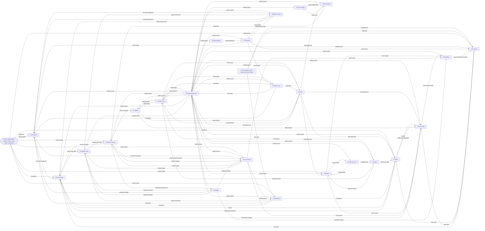

# Team map

Created by @meta_alchemist (https://x.com/meta_alchemist). Generated by `npm run team` from every `template.json`; do not edit by hand.

Every template works alone. Run two or more in the same game project and they hand work to each other through files, so nobody retypes findings. This page shows who makes what and who reads it. The contract for each file is in [spec/artifacts/](../spec/artifacts/), the shared memory record is [spec/shared-memory.schema.json](../spec/shared-memory.schema.json), and version rules are in [VERSIONING.md](VERSIONING.md). Team spec 1.0.0.

## How the files flow

Every template also reads the owner's `game-profile` and `evidence-pack`; those arrows are left out to keep the picture readable.



## Who makes what

| Producer | Artifact | Consumer | File format |
|---|---|---|---|
| 21 Access | [`access-report`](../spec/artifacts/access-report.schema.json) | 14 NPC and Lore, 19 Store Page, 28 App Store | JSON plus a Markdown summary |
| 03 Prop and Rig | [`asset-budget-report`](../spec/artifacts/asset-budget-report.schema.json) | 11 Environment | JSON |
| 17 Sprites | [`atlas-manifest`](../spec/artifacts/atlas-manifest.schema.json) | 01 Game Feel, 09 HUD, 19 Store Page | JSON plus the packed atlas images |
| 13 Audio | [`audio-mix-report`](../spec/artifacts/audio-mix-report.schema.json) | 01 Game Feel, 10 Trailer, 21 Access | JSON |
| 26 Balance Patch | [`balance-patch-draft`](../spec/artifacts/balance-patch-draft.schema.json) | 06 Economy, 20 Patch Notes, 27 Retention | Markdown proposal and patch-notes drafts plus JSON |
| Owner, 18 Bug Desk | [`change-list`](../spec/artifacts/change-list.schema.json) | 06 Economy, 10 Trailer, 20 Patch Notes | JSON (closures verified on the fixed build) |
| 10 Trailer | [`clip-list`](../spec/artifacts/clip-list.schema.json) | 19 Store Page, 20 Patch Notes | JSON |
| 27 Retention | [`cohort-report`](../spec/artifacts/cohort-report.schema.json) | 05 Game Loop, 06 Economy, 12 Producer, 26 Balance Patch | JSON plus a Markdown report draft |
| 20 Patch Notes | [`creator-shortlist`](../spec/artifacts/creator-shortlist.schema.json) | the owner | JSON with outreach drafts |
| 14 NPC and Lore | [`dialogue-draft`](../spec/artifacts/dialogue-draft.schema.json) | 13 Audio, 21 Access | JSON plus a Markdown dialogue draft |
| 06 Economy | [`economy-change-list`](../spec/artifacts/economy-change-list.schema.json) | 20 Patch Notes, 22 Live Service, 26 Balance Patch | JSON plus a Markdown proposal draft |
| 15 Server Fairness | [`enforcement-policy-draft`](../spec/artifacts/enforcement-policy-draft.schema.json) | 22 Live Service, 24 Ledger | Markdown local draft plus a JSON rule list |
| 24 Ledger | [`entitlement-ledger`](../spec/artifacts/entitlement-ledger.schema.json) | 06 Economy, 22 Live Service, 23 Support Desk, 28 App Store | JSON plus a text digest draft |
| Owner, 02 Playtest | [`evidence-pack`](../spec/artifacts/evidence-pack.schema.json) | Every template | JSON evidence pack plus a local manifest |
| 15 Server Fairness | [`fairness-findings`](../spec/artifacts/fairness-findings.schema.json) | 17 Sprites, 20 Patch Notes, 22 Live Service | JSON plus a Markdown summary |
| 01 Game Feel | [`feel-findings`](../spec/artifacts/feel-findings.schema.json) | 02 Playtest, 05 Game Loop, 09 HUD, 13 Audio, 17 Sprites | JSON |
| Owner | [`game-profile`](../spec/artifacts/game-profile.schema.json) | Every template | JSON |
| Every template | [`grade-record`](../spec/artifacts/grade-record.schema.json) | 12 Producer | JSON (the engine's grade record) |
| 09 HUD | [`hud-capture-set`](../spec/artifacts/hud-capture-set.schema.json) | 01 Game Feel, 02 Playtest, 10 Trailer, 11 Environment, 19 Store Page, 21 Access | JSON manifest plus lossless PNG screenshots and UI traces |
| 22 Live Service | [`incident-report`](../spec/artifacts/incident-report.schema.json) | 15 Server Fairness, 18 Bug Desk, 23 Support Desk | Markdown local draft plus JSON |
| 11 Environment | [`layout-brief`](../spec/artifacts/layout-brief.schema.json) | 03 Prop and Rig, 15 Server Fairness | JSON plus a Markdown draft |
| 25 Matchmaking | [`lobby-fill-proposal`](../spec/artifacts/lobby-fill-proposal.schema.json) | 27 Retention | JSON plan plus a Markdown proposal draft |
| 05 Game Loop | [`loop-report`](../spec/artifacts/loop-report.schema.json) | 01 Game Feel, 02 Playtest, 06 Economy, 09 HUD | JSON plus a Markdown loop map draft |
| 10 Trailer | [`media-export-manifest`](../spec/artifacts/media-export-manifest.schema.json) | 19 Store Page, 20 Patch Notes | JSON manifest plus the exported video and still files |
| 20 Patch Notes | [`patch-notes-draft`](../spec/artifacts/patch-notes-draft.schema.json) | 23 Support Desk | Markdown draft plus a JSON map from each line to its change |
| 12 Producer | [`pitch-draft`](../spec/artifacts/pitch-draft.schema.json) | 10 Trailer, 19 Store Page | Markdown slide draft plus a JSON claim list |
| 19 Store Page | [`store-asset-manifest`](../spec/artifacts/store-asset-manifest.schema.json) | 20 Patch Notes, 28 App Store | JSON manifest plus the store copy, art and archive files |
| 28 App Store | [`store-submission-checklist`](../spec/artifacts/store-submission-checklist.schema.json) | 12 Producer | Markdown checklist draft plus JSON findings |
| 23 Support Desk | [`support-case-draft`](../spec/artifacts/support-case-draft.schema.json) | 15 Server Fairness, 18 Bug Desk, 24 Ledger, 26 Balance Patch | JSON local drafts plus a JSON digest |
| Every template | [`ticket-draft`](../spec/artifacts/ticket-draft.schema.json) | 12 Producer, 18 Bug Desk | JSON or Markdown local draft |
| Owner | [`tracker-export`](../spec/artifacts/tracker-export.schema.json) | 06 Economy, 12 Producer, 15 Server Fairness, 18 Bug Desk, 21 Access, 22 Live Service | JSON |
| 22 Live Service | [`trust-records`](../spec/artifacts/trust-records.schema.json) | 19 Store Page, 28 App Store | JSON |
| 12 Producer | [`work-plan`](../spec/artifacts/work-plan.schema.json) | 20 Patch Notes | JSON plus a Markdown plan draft |

## Where the files live in your game project

```
your-game/
  .grokbot-team/
    artifacts/<artifact>/<UTC date>-<label>.json   one folder per artifact, newest sorts last
    memory/<topic>.jsonl                            append-only shared memory, one file per topic
```

A consumer reads the newest file in the folder. When a folder is empty or missing, an optional input is skipped with a clearly marked assumption ("ASSUMPTION: no feel-findings available") and the lines that needed it stay unmeasured. A required input (the owner's game profile and evidence pack) stops the run and the bot asks the owner. No template ever invents the missing data. Check a file against its contract with `node scripts/check-artifact.mjs <file or folder>`.

## Shared memory topics

Templates read the topics they need before acting and append only to the topics they own. See [SHARED-MEMORY.md](SHARED-MEMORY.md).

| Topic | Written by | Read by |
|---|---|---|
| `decisions` | Every template | Every template |
| `incidents` | 22 Live Service, 23 Support Desk | 12 Producer, 15 Server Fairness, 18 Bug Desk, 22 Live Service, 23 Support Desk, 24 Ledger, 25 Matchmaking, 26 Balance Patch, 27 Retention, 28 App Store |
| `entitlements` | 22 Live Service, 24 Ledger | 06 Economy, 12 Producer, 22 Live Service, 23 Support Desk, 28 App Store |
| `balance` | 06 Economy, 26 Balance Patch | 05 Game Loop, 06 Economy, 12 Producer, 20 Patch Notes, 23 Support Desk, 26 Balance Patch, 27 Retention |
| `regions` | 25 Matchmaking | 12 Producer, 15 Server Fairness, 22 Live Service, 27 Retention |
| `releases` | 12 Producer, 18 Bug Desk, 20 Patch Notes, 28 App Store | 01 Game Feel, 03 Prop and Rig, 05 Game Loop, 06 Economy, 09 HUD, 10 Trailer, 11 Environment, 12 Producer, 13 Audio, 14 NPC and Lore, 17 Sprites, 18 Bug Desk, 19 Store Page, 20 Patch Notes, 21 Access, 22 Live Service, 23 Support Desk, 24 Ledger, 25 Matchmaking, 26 Balance Patch, 27 Retention |

## Check compatibility

`npm run compat` reports OK, WARN or BREAK for every pair of templates in the table above, with the reason and the fix.
